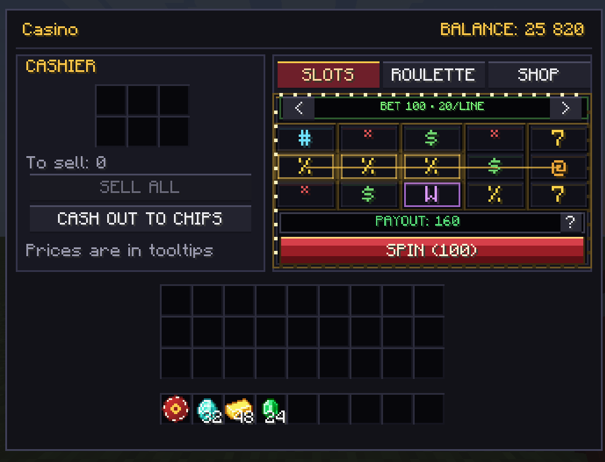
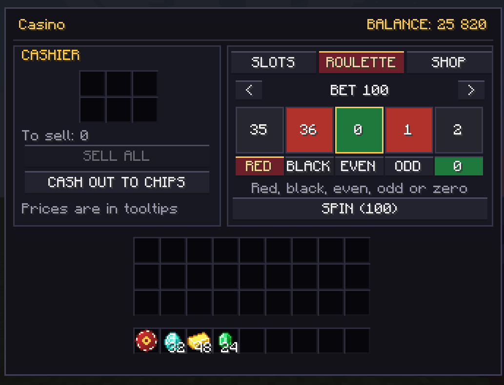
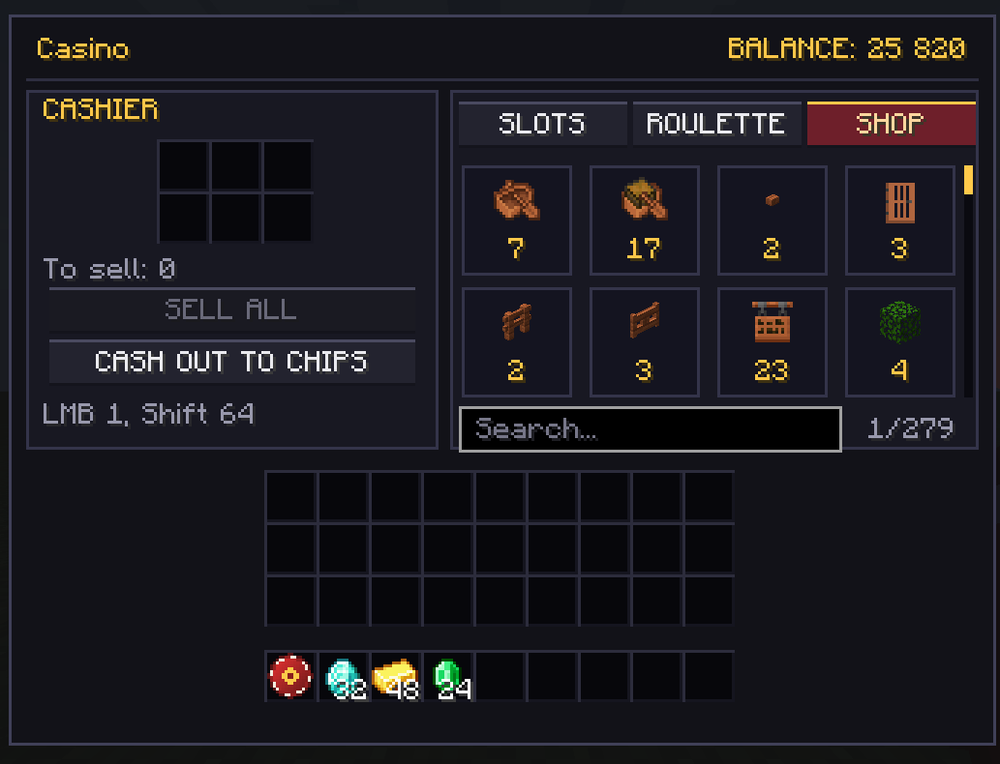
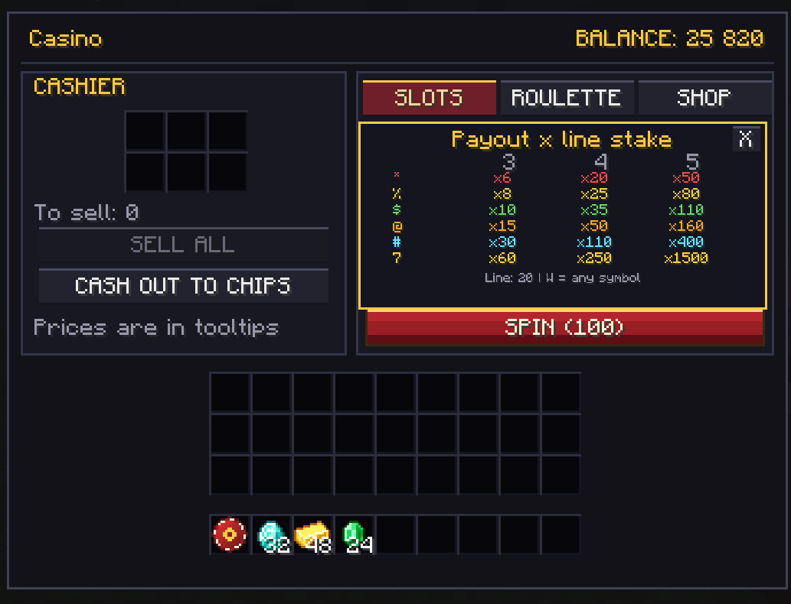

# CasinoCraft

**A full casino for Minecraft 1.20.1 (Fabric): cashier, slots, roulette, a shop for 1100+ items and physical chips.**

[](https://www.minecraft.net/)
[](https://fabricmc.net/)
[](https://adoptium.net/)
[](LICENSE)

[Русская версия](README.ru.md)



## What is it

CasinoCraft turns the value of ordinary Minecraft items into a casino economy:

* **Cashier** — deposit ores, blocks, food, mob drops, tools and armor; the mod prices them and pays coins.
* **Slots** — 5×3 field, five fixed paylines, Wild substitution, total stakes from 10 to 50 000.
* **Roulette** — European wheel (37 numbers): red/black, even/odd and zero.
* **Shop** — almost every item in the registry (1118 in vanilla 1.20.1), with search and scrolling.
* **Chips** — physical money you can withdraw, trade with other players and deposit back 1:1.
* **Visual effects** — reel motion trails, soft landing/win glows, gold win sparks and a special five-sevens line jackpot (Wilds allowed). The Minecraft Particles setting controls spark density; Minimal also disables trails. Effects are client-only and do not change outcomes.

Everything is server-authoritative: the client only plays animations, it cannot rig results or prices.

## Features

| | |
|---|---|
| **Cashier** | 6 deposit slots, live "to sell" preview, sells nearly everything (ores, gear, loot) |
| **Slots** | Server RNG, 0.9 s cooldown, 5×3, 5 lines, Wild, theoretical return ≈ 96.18% |
| **Roulette** | European wheel, 2x on red/black/even/odd, 36x on zero, house edge ≈ 2.7% |
| **Shop** | 1118 buyable items, search by name/ID, mouse-wheel scroll, `LMB` = 1, `Shift+LMB` = 64 |
| **Chips** | "Chip 100" / "Chip 10" items, fixed face value, 1:1 deposit/withdraw |
| **Pricing** | Upgrader-inspired base table + recipe-derived prices + automatic anti-arbitrage clamps |
| **Commands** | `/casino balance`, `/casino top`, `/casino give`, `/casino set`, `/casino reload` |
| **Config** | `config/casinocraft-prices.json`, editable live with `/casino reload` |

## Screenshots

The images below show the earlier 1.5 interface; version 1.7 replaces the slot panel with the 5×3 field.

| Slots | Roulette |
|---|---|
|  |  |

| Shop | Paytable |
|---|---|
|  |  |

## Installation

1. Install **Fabric Loader 0.16.10+** for **Minecraft 1.20.1**.
2. Put these files into `.minecraft/mods`:
   * `casinocraft-1.7.0.jar`
   * [Fabric API 0.92.x for 1.20.1](https://modrinth.com/mod/fabric-api)
3. Launch the game.

On a server the mod must be installed **on both server and client** (the interface is client-side).

### Getting the casino pass

Craft it:

```
  G
 GEG      G — gold ingot
  R       E — emerald
          R — block of redstone
```

or use `/give @s casinocraft:casino_chip`.

## How to play

1. Right-click the **Casino Chip** to open the interface.
2. Put items into the cashier slots and press **SELL ALL** — your balance grows.
3. Switch to **SLOTS** or **ROULETTE**, choose a bet with `<` / `>` and press **SPIN**.
4. Use the **SHOP** tab to spend your balance on items.
5. Use **CASH OUT TO CHIPS** to turn your balance into physical chips.

### Shop controls

* **Search field** at the bottom — filters by localized name or item ID.
* **Mouse wheel / scrollbar** — navigate the whole catalogue.
* **LMB** — buy 1, **Shift + LMB** — buy up to 64.
* Prices turn red when you cannot afford them.

### What can be sold

Almost everything with a sane value:

* ores, ingots, nuggets, blocks, food, mob drops — Upgrader base table;
* tools, weapons and armor — recipe cost (diamond sword 800, diamond pickaxe 1200, diamond helmet 2000);
* netherite gear — smithing cost (diamond item + netherite ingot + template), e.g. sword 6217;
* items without recipes — rarity fallback (3 / 150 / 600 / 2500).

Tools and armor are valued by **remaining durability**. Enchantments are not counted.

Not accepted: technical blocks, potions, enchanted books, written books, maps, spawn eggs, and "converter" blocks (cobweb, amethyst cluster, gilded blackstone, wet sponge).

## Economy and anti-abuse

The mod is built to survive players who like spreadsheets:

* **Server-side results.** Bets, RNG, prices and payouts are calculated on the server.
* **Shop markup.** Shop price is `max(configured, sell × 1.25)`, so buy → sell is always a loss.
* **Automatic crafting clamp.** At world load the mod walks every recipe (crafting, smelting, stonecutting, smithing) and lowers the sell price of the result if ingredients are worth more. One log 4 coins cannot produce planks worth 8. Iron ingots settle at 36 because 9 nuggets are 36.
* **Ores are not sold in the shop.** Diamond ore for 4 coins and a furnace would be a money printer; rather than guess Fortune yields, ore blocks are excluded from the catalogue.
* **Face-value chips.** Chip 100 is always 100 coins in both directions, fixed in code, not in config. No config can turn a chip into 1000.
* **Withdraw limit.** 38 400 per click (6 stacks) to avoid dumping thousands of item entities.
* **Durability matters.** A used sword is worth less than a new one.

Large payouts get a client-only celebration: **BIG ≥10×**, **MEGA ≥25×**, **EPIC ≥100×** of the total stake. A gold coin shower and animated payout counter show the already-settled server result; net profit is labeled separately. Click the banner to reveal the full payout, press Esc to dismiss, or start another spin. Changing tabs or opening the paytable also dismisses it. The Minecraft particle setting controls coin density; Minimal disables coins. The roulette uses a compact banner above its bet buttons.

### Video slot rules

* The displayed stake is the **total spin cost**, divided equally over all five lines; no extra charge per line. Stakes must be divisible by 5.
* Lines are the top, middle and bottom rows, plus V and inverted V. Matches start on the leftmost reel and must be consecutive: 3, 4 or 5 symbols.
* **W (Wild)** substitutes for every regular symbol. Each line pays only its highest available award; leading Wilds and an all-Wild line use the most valuable interpretation.
* The `?` button opens the paytable. Multipliers apply to the **line stake**, not the total stake. Winning line payouts are added together; the displayed payout is the gross amount credited, not net profit.
* Example: a total stake of 100 means 20 per line. Three cherries on one line pay `20 × 6 = 120`.

| Symbol | 3 | 4 | 5 |
|---|---:|---:|---:|
| Cherry (*) | 6× | 20× | 50× |
| Lemon (%) | 8× | 25× | 80× |
| Dollar ($) | 10× | 35× | 110× |
| Bell (@) | 15× | 50× | 160× |
| Diamond (#) | 30× | 110× | 400× |
| Seven (7) | 60× | 250× | 1500× |

All 15 cells are drawn independently on the server. Symbol weights are 28/24/18/15/8/5/2 for the symbols above followed by Wild. Exact weighted enumeration of all 16,807 possible five-symbol lines gives **96.1830768% theoretical return** (house edge **3.8169232%**). Shared cells correlate line wins, but do not change their combined expected return. These are long-run averages, not a session guarantee. Pairs do not pay.


## Configuration

`config/casinocraft-prices.json` is generated on first launch:

```json
{
  "sell": {
    "minecraft:diamond": 400,
    "minecraft:emerald": 140,
    "#minecraft:logs": 4
  },
  "shop": {
    "minecraft:emerald": 210,
    "minecraft:diamond": 600
  }
}
```

* `sell` — what the cashier pays. Keys starting with `#` are item tags.
* `shop` — explicit shop prices (everything else is derived).
* Values are per **single item**; stack size is applied automatically.
* After editing run `/casino reload` or restart. Open casino screens receive the updated server prices automatically.
* Clients display server prices; their local price config does not affect the shop or cashier preview.
* If a price changes during a purchase, the server cancels it without charging and refreshes the prices.
* Install this update on both server and clients: the purchase packet includes the displayed price, and slot results contain a 15-cell grid.

A legacy flat config (`{"minecraft:diamond": 120}`) is still read as `sell`.

## Commands

| Command | Permission | Description |
|---|---|---|
| `/casino balance` | everyone | your balance |
| `/casino balance <player>` | everyone | another player's balance |
| `/casino top` | everyone | top 5 balances |
| `/casino give <players> <amount>` | op | add coins |
| `/casino set <players> <amount>` | op | set balance |
| `/casino reload` | op | reload prices |

## Building from source

Requirements: **JDK 17** (Gradle wrapper included).

```bash
./gradlew build
```

The jar appears in `build/libs/casinocraft-1.7.0.jar`.

Dev client with a test world:

```bash
./gradlew runClient
```

## Project layout

```
src/main/java/com/casinocraft/
  CasinoCraftMod.java            entrypoint
  ModItems.java                  pass, chips, creative tab
  CasinoLayout.java              shared GUI geometry
  item/                          casino pass and chip items
  screen/CasinoScreenHandler.java  cashier slots + balance sync
  economy/ItemPrices.java        prices, recipe index, anti-arbitrage
  economy/PlayerBalances.java    per-player balances (persistent)
  economy/CasinoEconomy.java     bets, payouts, selling, buying, withdrawal
  game/SlotMachine.java          slots logic and paytable
  game/Roulette.java             roulette logic
  network/ModNetworking.java     C2S packets
  client/CasinoScreen.java       entire interface, drawn in code
  client/ClientNetworking.java   S2C packets
  command/CasinoCommands.java    /casino ...
```

The GUI is drawn programmatically — no textures to break with resource packs. Localization: English and Russian.

## License and disclaimer

MIT — see [LICENSE](LICENSE).

CasinoCraft is a game mod. All currency, chips and bets are virtual and have no real-world value. It does not connect to any online casino, does not process payments and is not intended for real-money gambling.
