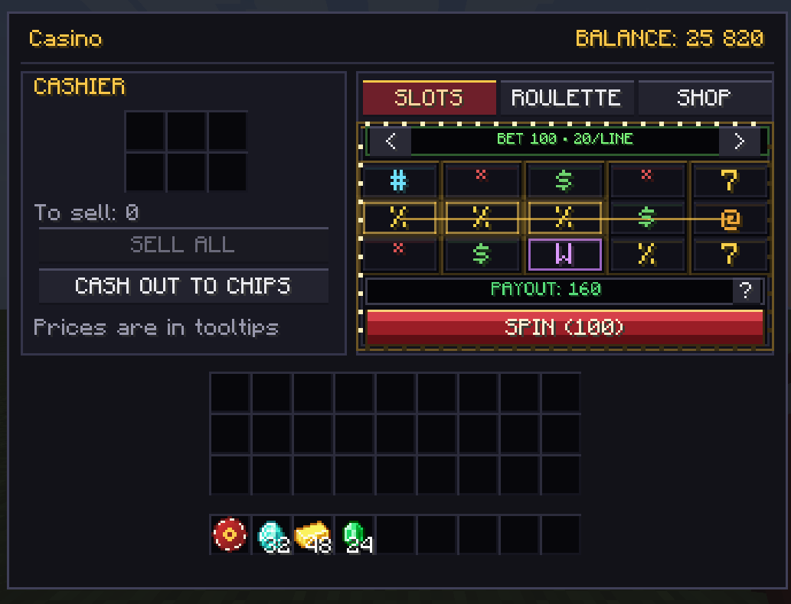
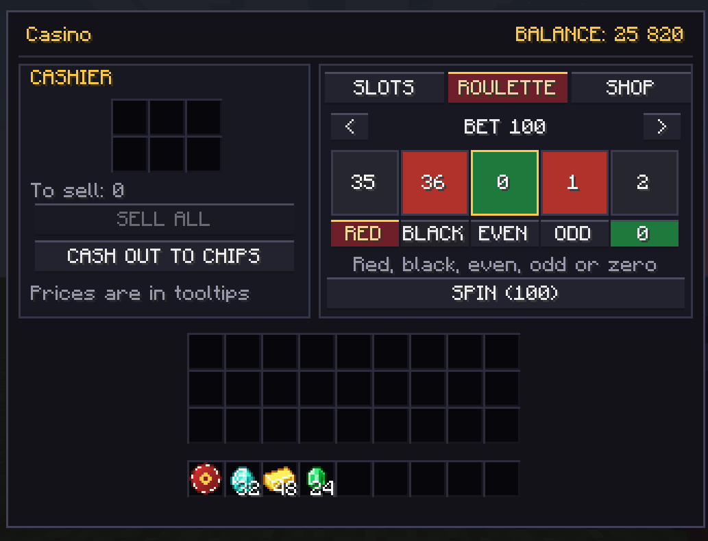
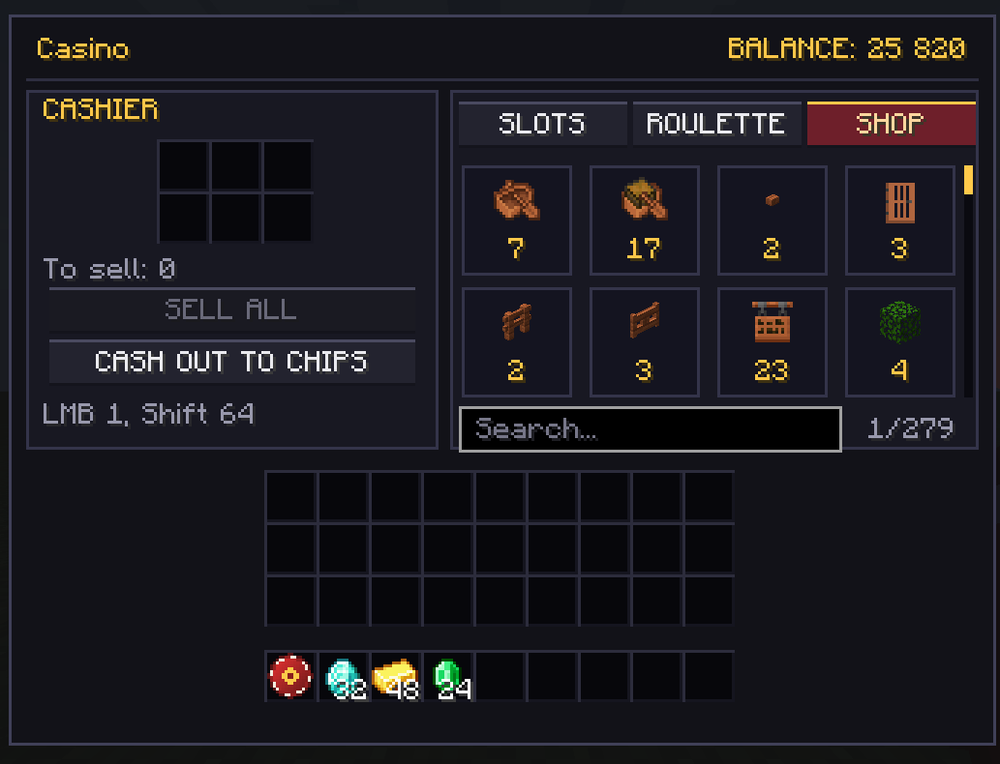
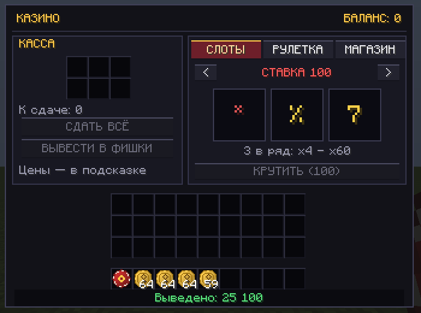

# CasinoCraft

**Полноценное казино для Minecraft 1.20.1 (Fabric): касса, слоты, рулетка, магазин на 1100+ предметов и физические фишки.**

[](https://www.minecraft.net/)
[](https://fabricmc.net/)
[](https://adoptium.net/)
[](LICENSE)

[English version](README.md)



## Что это

CasinoCraft превращает ценность обычных предметов Minecraft в экономику казино:

* **Касса** — сдаёте руду, блоки, еду, дроп мобов, инструменты и броню; мод оценивает их и платит монетами.
* **Слоты** — три барабана, шесть символов, ставки от 10 до 50 000, выплаты x4–x60.
* **Рулетка** — европейское колесо (37 чисел): красное/чёрное, чёт/нечет и зеро.
* **Магазин** — почти весь реестр предметов (1118 в ванильном 1.20.1), с поиском и прокруткой.
* **Фишки** — физические деньги: их можно вывести, передать другому игроку и сдать обратно 1:1.
* **Визуальные эффекты** — шлейфы вращения, мягкое свечение при остановке и выигрыше, золотые искры и отдельный джекпот за три семёрки. Настройка частиц Minecraft регулирует количество искр; минимальный режим также отключает шлейфы. Эффекты работают на клиенте и не меняют исход игры.

Все результаты считает **сервер**: клиент только проигрывает анимацию и не может подкрутить исход или цену.

## Возможности

| | |
|---|---|
| **Касса** | 6 слотов, живой предпросмотр «К сдаче», принимает почти всё (руды, снаряжение, лут) |
| **Слоты** | RNG на сервере, кулдаун 0.9 с, перевес казино ≈ 15.41% |
| **Рулетка** | Европейское колесо, 2x на красное/чёрное/чёт/нечет, 36x на зеро, перевес ≈ 2.7% |
| **Магазин** | 1118 товаров, поиск по названию/ID, колесо мыши, `ЛКМ` = 1, `Shift+ЛКМ` = 64 |
| **Фишки** | «Фишка 100» и «Фишка 10», фиксированный номинал, обмен с балансом 1:1 |
| **Цены** | база в духе Upgrader + расчёт по рецептам + автозащита от арбитража |
| **Команды** | `/casino balance`, `/casino top`, `/casino give`, `/casino set`, `/casino reload` |
| **Конфиг** | `config/casinocraft-prices.json`, перечитывается командой `/casino reload` |

## Скриншоты

| Слоты | Рулетка |
|---|---|
|  |  |

| Магазин | Вывод |
|---|---|
|  |  |

## Установка

1. Установите **Fabric Loader 0.16.10+** для **Minecraft 1.20.1**.
2. Положите в `.minecraft/mods`:
   * `casinocraft-1.6.0.jar`
   * [Fabric API 0.92.x для 1.20.1](https://modrinth.com/mod/fabric-api)
3. Запустите игру.

На сервере мод нужен **и на сервере, и на клиенте** (интерфейс клиентский).

### Как получить жетон казино

Скрафтите:

```
  G
 GEG      G — золотой слиток
  R       E — изумруд
          R — блок редстоуна
```

или используйте `/give @s casinocraft:casino_chip`.

## Как играть

1. ПКМ **жетоном казино** — откроется интерфейс.
2. Положите предметы в слоты кассы и нажмите **«Сдать всё»** — баланс пополнится.
3. Переключитесь на **«Слоты»** или **«Рулетку»**, выберите ставку кнопками `<` / `>` и нажмите **«Крутить»**.
4. Вкладка **«Магазин»** — трата баланса на предметы.
5. Кнопка **«Вывести в фишки»** — превращает баланс в физические фишки.

### Управление в магазине

* **Поиск** внизу — по названию или ID предмета.
* **Колесо мыши / полоса прокрутки** — навигация по каталогу.
* **ЛКМ** — купить 1, **Shift + ЛКМ** — до 64.
* Цена краснеет, если денег не хватает.

### Что можно сдать

Практически всё, у чего есть разумная цена:

* руды, слитки, самородки, блоки, еда, дроп мобов — базовая таблица Upgrader;
* инструменты, оружие и броня — по стоимости рецепта (алмазный меч 800, кирка 1200, шлем 2000);
* незеритовые вещи — по стоимости смитинга (алмазная вещь + слиток + шаблон), меч 6217;
* предметы без рецепта — по редкости (3 / 150 / 600 / 2500).

Инструменты и броня оцениваются по **остатку прочности**. Зачарования не учитываются.

Не принимаются: технические блоки, зелья, зачарованные книги, книги с текстом, карты, яйца призыва и блоки-конвертеры (паутина, аметистовый кластер, позолоченный чернокамень, мокрая губка).

## Экономика и защита от абузов

* **Всё считает сервер.** Ставки, RNG, цены и выплаты — на сервере.
* **Наценка магазина.** Цена покупки `max(из конфига, sell × 1.25)`, поэтому «купил → сдал» всегда в минус.
* **Автозащита от крафта.** При загрузке мира мод проходит по всем рецептам (крафт, плавка, камнерез, смитинг) и понижает цену результата, если ингредиенты стоят дороже. Из бревна за 4 не получить доски на 8; слиток железа сходится к 36, потому что 9 самородков — это 36.
* **Руды не продаются в магазине.** Алмазная руда за 4 монеты и печка — это печатный станок; вместо угадывания дропа с Fortune руды исключены из каталога.
* **Фишки по номиналу.** Фишка 100 всегда равна 100 монетам в обе стороны, номинал зашит в код и не читается из конфига.
* **Лимит вывода.** 38 400 за клик (6 стаков), чтобы не заваливать мир дропом.
* **Прочность учитывается.** Использованный меч стоит меньше нового.

Теоретический возврат слотов — **84.5946%**, перевес казино — **15.4054%**, с учётом возврата ставки за пары. Это средние значения на большой дистанции, а не гарантия результата за игровую сессию.

## Конфигурация

`config/casinocraft-prices.json` создаётся при первом запуске:

```json
{
  "sell": {
    "minecraft:diamond": 400,
    "minecraft:emerald": 140,
    "#minecraft:logs": 4
  },
  "shop": {
    "minecraft:emerald": 210,
    "minecraft:diamond": 600
  }
}
```

* `sell` — по какой цене касса покупает. Ключи с `#` — теги предметов.
* `shop` — явные цены магазина (остальное считается автоматически).
* Цена за **1 штуку**, количество учитывается само.
* После правки — `/casino reload` или перезапуск. Открытые окна казино автоматически получают обновлённые серверные цены.
* Магазин и предпросмотр кассы используют цены сервера, а не локальный конфиг клиента.
* Если цена изменилась во время покупки, сервер отменяет её без списания и обновляет цены.
* Обновление нужно установить и на сервер, и на клиенты: пакет покупки теперь содержит показанную цену.

Старый «плоский» формат (`{"minecraft:diamond": 120}`) тоже читается как `sell`.

## Команды

| Команда | Права | Что делает |
|---|---|---|
| `/casino balance` | все | свой баланс |
| `/casino balance <игрок>` | все | баланс другого игрока |
| `/casino top` | все | топ-5 по балансу |
| `/casino give <игроки> <сумма>` | оператор | начислить монеты |
| `/casino set <игроки> <сумма>` | оператор | установить баланс |
| `/casino reload` | оператор | перечитать цены |

## Сборка из исходников

Нужен **JDK 17** (Gradle wrapper уже в репозитории).

```bash
./gradlew build
```

Готовый jar: `build/libs/casinocraft-1.6.0.jar`.

Dev-клиент:

```bash
./gradlew runClient
```

## Структура проекта

```
src/main/java/com/casinocraft/
  CasinoCraftMod.java            точка входа
  ModItems.java                  жетон, фишки, вкладка в креативе
  CasinoLayout.java              общая геометрия интерфейса
  item/                          предметы жетона и фишек
  screen/CasinoScreenHandler.java  слоты кассы + синхронизация баланса
  economy/ItemPrices.java        цены, индекс рецептов, анти-арбитраж
  economy/PlayerBalances.java    балансы игроков (PersistentState)
  economy/CasinoEconomy.java     ставки, выплаты, продажа, покупка, вывод
  game/SlotMachine.java          логика слотов и таблица выплат
  game/Roulette.java             логика рулетки
  network/ModNetworking.java     пакеты C2S
  client/CasinoScreen.java       весь интерфейс, рисуется кодом
  client/ClientNetworking.java   пакеты S2C
  command/CasinoCommands.java    /casino ...
```

Интерфейс рисуется программно — текстуры не ломаются ресурспаками. Локализация: английский и русский.

## Лицензия и дисклеймер

MIT — см. [LICENSE](LICENSE).

CasinoCraft — игровой мод. Вся валюта, фишки и ставки виртуальные и не имеют реальной ценности. Мод не подключается к онлайн-казино, не обрабатывает платежи и не предназначен для игры на реальные деньги.
